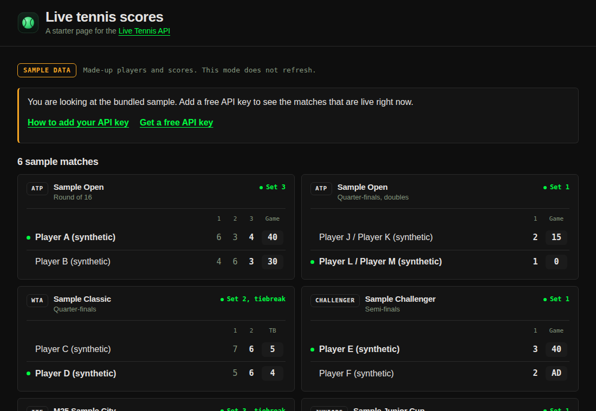

<a href="https://livetennisapi.com"></a>

# livetennisapi-starter-web

**A live tennis scores page in plain HTML and JavaScript, built on the official [Live Tennis API](https://livetennisapi.com) client.**

[Website](https://livetennisapi.com) · [Docs](https://docs.livetennisapi.com) · [Pricing](https://livetennisapi.com/pricing) · [Changelog](https://docs.livetennisapi.com/changelog.html) · [Dashboard](https://livetennisapi.com/account/) · [Get a free API key](https://livetennisapi.com/subscribe/free)

[](https://github.com/livetennisapi/livetennisapi-starter-web/actions/workflows/ci.yml)
[](https://www.npmjs.com/package/livetennisapi)
[](LICENSE)

[](https://app.netlify.com/start/deploy?repository=https://github.com/livetennisapi/livetennisapi-starter-web)

One static page that lists the tennis matches live right now, for ATP, WTA, Challenger, ITF and juniors. It calls the API through the [`livetennisapi`](https://www.npmjs.com/package/livetennisapi) npm package and refreshes on a schedule that a free API key can sustain all day. With no key it shows bundled sample data, so you can see it work before you sign up.



## Run it

You need Node.js 22 or later.

```bash
git clone https://github.com/livetennisapi/livetennisapi-starter-web.git
cd livetennisapi-starter-web
npm install
npm start
```

Open <http://localhost:8080>. `npm start` builds the page into `dist/` and serves that folder. `npm run build` only builds it, for any static host.

## Keyless mode

Without an API key, the page reads [`public/sample/live-matches.json`](public/sample/live-matches.json) and says so at the top. The file has the shape of a real `GET /matches?status=live` answer, as the [API reference](https://docs.livetennisapi.com/live-scores.html) describes it. The players and tournaments in it are made up ("Player A (synthetic)", "Sample Open"), so nothing in it reads as a real result. In this mode the page never calls the API and never refreshes.

## Add your key

1. Get a free key at [livetennisapi.com/subscribe/free](https://livetennisapi.com/subscribe/free). No card is needed.
2. Copy the example file and put the API key after `LIVETENNISAPI_KEY=`:

   ```bash
   cp .env.example .env
   ```

3. Run `npm start` again.

On a static host, set `LIVETENNISAPI_KEY` in the host's settings instead. The build reads it from the environment, and the environment wins over `.env`. The file is in `.gitignore`, so the API key stays out of your commits and your shell history.

**Use a FREE key only.** The build writes the API key into `dist/app.js`, and anyone who opens the page can read it there. The client's own [README](https://github.com/livetennisapi/livetennisapi-js#install) says the same: a free API key in browser code is fine, a paid one never is. Every visitor also spends the same key's daily allowance. A page for many people needs a small server that holds the key and caches the answer.

## How the refresh stays inside the free plan

The [FREE plan](https://docs.livetennisapi.com/errors-and-rate-limits.html) allows 30 requests a minute and 100 a day. The page spends one request per refresh and asks for up to 100 live matches in it. The client's own retries are off, so a failed refresh is still one request, and it waits for the next one. A 429, 403 or 404 does not count against the day's 100.

- It refreshes every 15 minutes (`REFRESH_INTERVAL_MS` in [`src/limits.js`](src/limits.js)). That is 96 requests in 24 hours.
- A reload or a second tab inside those 15 minutes reuses the last answer from `localStorage` instead of calling again.
- A hidden tab does not refresh. It catches up when you come back.
- When the day's allowance is spent, the page waits until the reset time the API sends. When the API key is rejected, every open tab says so and waits an hour before it tries again.

A unit test fails if the interval would break the documented limits. To refresh faster you need a paid plan, and with a paid plan the API key belongs on a server, not in this page.

## Deploy

The **Deploy to Netlify** button above copies this repository to your GitHub account and builds it with the settings in [`netlify.toml`](netlify.toml). The first deploy shows the sample data. To go live:

1. In Netlify, open your project, then **Project configuration**, then **Environment variables**.
2. Add `LIVETENNISAPI_KEY` with your free API key. Leave **Contains secret values** unticked. Netlify fails any build that puts a marked secret into the output, and this page has to carry the key.
3. Open **Deploys** and choose **Trigger deploy**, then **Deploy project**.

If Netlify's [smart detection](https://docs.netlify.com/build/environment-variables/secrets-controller/) still stops the build, add the key to `SECRETS_SCAN_SMART_DETECTION_OMIT_VALUES` as that page describes.

Any static host works the same way: run `npm run build` and publish `dist/`.

## What is in the repository

| Path | What it does |
| --- | --- |
| `src/main.js` | Picks keyless or live mode, calls `listMatches`, schedules the refresh |
| `src/limits.js` | The FREE plan limits and the refresh interval |
| `src/refresh.js` | When the next request can go out, and what each API error means |
| `src/score.js` | Reads a match into rows and columns with the client's `gamesForSet` |
| `src/render.js` | Builds the match cards (text only, never HTML from the API) |
| `src/store.js` | Shares the last answer and the last request time between reloads and tabs |
| `src/messages.js` | Every sentence the script shows |
| `src/index.html`, `src/styles.css` | The page and its styles |
| `public/sample/live-matches.json` | The keyless sample |
| `scripts/build.mjs` | Bundles the page with esbuild into `dist/` |
| `scripts/serve.mjs` | A small local server for `npm start` |
| `scripts/truthcheck.sh` | Fails CI if a stale product fact shows up in the text |
| `test/` | Unit tests (`node --test`) and browser tests (Playwright) |

## Tests

```bash
npm test                            # unit tests, no network
npx playwright install chromium     # once
npm run test:e2e                    # the page in a headless browser
```

The browser tests build the page twice. One build is keyless. The other has a placeholder key, and the tests answer its API calls themselves, so they never reach the real API.

## Next steps

- Add the upcoming matches with `listFixtures()`. It is on the FREE plan too.
- Show one match in detail with `getMatch(id)`.
- Read the [live scores guide](https://docs.livetennisapi.com/live-scores.html) for every field on a match.
- See the other [client libraries](https://docs.livetennisapi.com/client-libraries.html).

## Licence

MIT. See [LICENSE](LICENSE). Use of the API is covered by the [Terms of Service](https://livetennisapi.com/terms).
